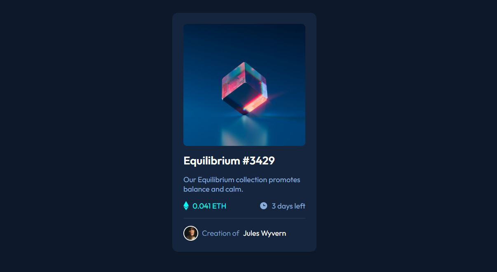

# Frontend Mentor - NFT preview card component solution

This is a solution to the [NFT preview card component challenge on Frontend Mentor](https://www.frontendmentor.io/challenges/nft-preview-card-component-HXjdUltW9). Frontend Mentor challenges help you improve your coding skills by building realistic projects.

## Overview

### Screenshot

### Links

- **Solution URL:** [GitHub Repository](https://github.com/eduardoseq17/NFT-Preview-Card)
- **Live Site URL:** [Live Site](https://eduardoseq17.github.io/NFT-Preview-Card/)

## Built with

- Semantic HTML5 markup (`<main>`, `<article>`, `<h1...>` )
- CSS Custom Properties (Variables)
- Mobile-first workflow & Responsive Design
- Modern CSS Architecture (CUBE CSS approach: Composición y Bloques)
- Flexbox for alignment and layout structuring
- Web Accessibility (a11y) best practices

## What I learned

While building this NFT preview card component, I focused on adopting modern CSS methodologies and refining my layout skills:

- **CUBE CSS Methodology:** Structured the project using a scalable approach, separating global foundations, custom properties, and modular blocks (`.nft-card`).
- **Interactive Overlay Effects:** Implemented a smooth hover state for the image gallery preview using absolute positioning, pseudo-elements (`::before`), and CSS transitions.
- **Custom Properties & Theming:** Centralized colors and design tokens inside a `:root` block for consistent maintainability.

## Continued development

In future projects, I want to keep focusing on:

- Deepening advanced layout techniques with CSS Grid and modern structural composition.
- Enhancing accessibility and focus states across interactive UI components.

## AI Collaboration

I collaborated with Gemini as an interactive coding partner to troubleshoot layout positioning, optimize the image hover overlay with pseudo-elements, and apply CUBE CSS principles cleanly.

## Author

- GitHub - [@eduardoseq17](https://github.com/eduardoseq17)
- Frontend Mentor - [@eduardoseq17](https://github.com/eduardoseq17)
